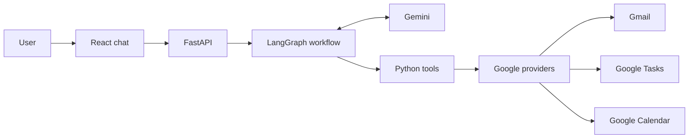

# BridgeAI Email Agent
## Simple architecture and workflow

### Architecture



### What happens when the user sends a message

```text
User sends a message
        ↓
FastAPI receives and validates it
        ↓
LangGraph sends it to Gemini
        ↓
Gemini answers, or asks a Python tool to do something
        ↓
The tool validates the request and calls the relevant provider
        ↓
The result goes back to Gemini
        ↓
FastAPI returns the answer to the chat UI
```

For example, to list emails, Gemini requests the email-list tool. The tool calls the Gmail provider, then sends the matching emails back to Gemini to write the response.

For task creation, the tool analyzes the selected email. Python applies the task rules and creates a task only when approved. Summarizing an email alone does not create a task.

### Main files

| File or folder | Purpose |
|---|---|
| `run.py` | Starts the local application. |
| `app/main.py` | Creates the app and connects routes, providers, and graph. |
| `app/api/routes/agent.py` | Receives chat messages and returns responses. |
| `app/agents/graph.py` | Controls the Gemini ↔ tool workflow. |
| `app/agents/tools.py` | Defines what the agent is allowed to do. |
| `app/services/ai_service.py` | Calls Gemini. |
| `app/services/task_decision_service.py` | Applies the task approval rules. |
| `app/integrations/` | Connects the app to Google services or local development providers. |
| `frontend/src/` | React chat interface. |

### In one sentence

**FastAPI receives the chat, LangGraph coordinates Gemini and Python tools, and provider adapters connect those tools to the user’s Google services.**

This is a local, single-user application. Each user configures their own Google authorization and Gemini API key. The current app is not a hosted multi-user production service.

### Email provider support

The provider contract is designed to allow adapters, but **Gmail is the only implemented email provider today**. Yahoo Mail, Outlook/Microsoft 365, and other mailboxes do not connect yet. Each provider needs its own adapter, sign-in flow, permission model, search behavior, and integration tests. The app cannot safely support a provider just by changing the email address.
